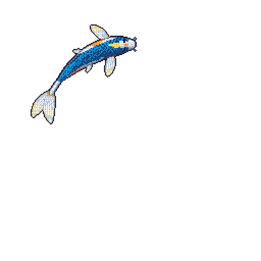

<h2> Hey there! </h2>

### A little bit about me...

💻 I'm Anson, a Computer Engineering student @ UBC 
 
🇭🇰 I was born in Hong Kong, but was raised in Australia for 15 years 
 
🎾 I love playing racket sports such as badminton, tennis, table tennis, and even pickleball 

### Currently...
- A software engineering intern @ ScalePad 🌱
- A software dev @ UBC Launch Pad  <!-- Attach a link to the Figma for SWE Project  --> 
- Reading "*Kafka on the Shore* (海辺のカフカ)"  by Haruki Murakami (村上 春樹)   

### Find Me Here...
- LinkedIn: [in/ansonnchan](https://www.linkedin.com/in/ansonnchan/)
- Email: ansonnchan95@gmail.com
- Personal Website: [ansonnchan.dev](https://www.ansonnchan.dev/)

 
 

  <table>
    <tr>
      <td align="center">
        
      </td>
    </tr>
  </table>

